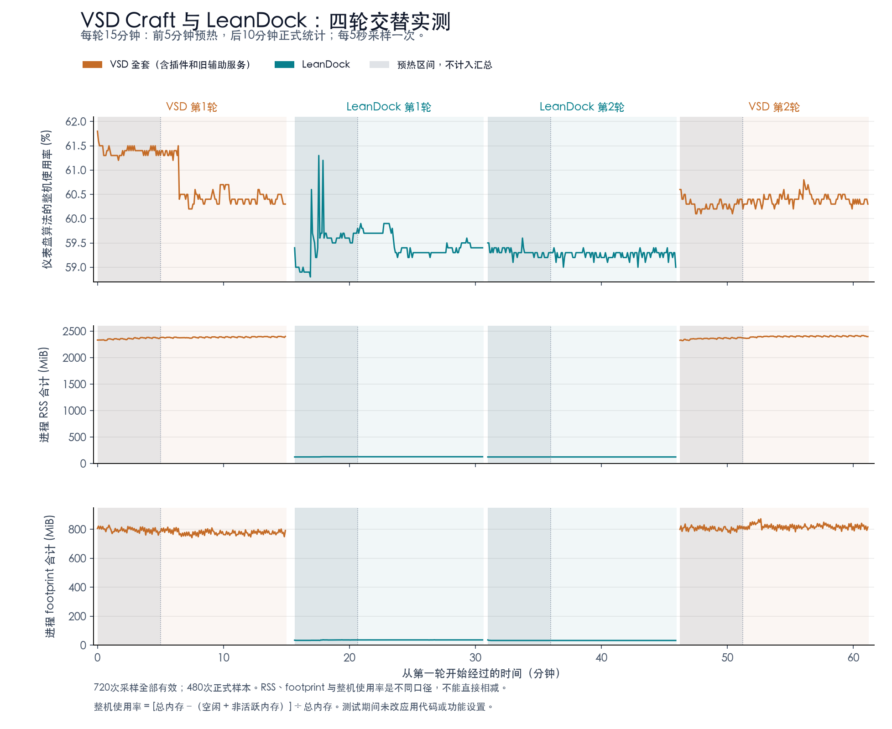

# VSD Craft 与 LeanDock 内存对比实测

2026-10-25，Asia/Shanghai；当前 Apple Silicon Mac，24 GiB 内存、M18。VSD Craft 3.10.205.0918，LeanDock 0.1.1。

## 结论

LeanDock 的内存开销确实显著低于 VSD，但原来的“VSD 约9%”不能从整机“60%”中直接扣除。

- 四轮正式样本中，进程 footprint 合计平均 **797.8 → 34.3 MiB**，减少 **763.5 MiB（约 95.7%）**。
- macOS 自带工具的轮末系统 footprint 快照，两次配对分别减少 **738 / 927 MiB**，平均约 **832 MiB**。这是每轮末的一次快照，用于交叉核对，不是连续采样平均值。
- 当前仪表盘算法的整机使用率平均 **60.48% → 59.36%**，只下降 **1.12 个百分点**，对应可用内存净增约 **275 MiB**。两次配对分别下降 1.09 / 1.14 个百分点。

这些是不同口径的观测，不能把 footprint、RSS 差值或某个整机快照都称为同一个“实际释放量”。本次证据支持：应用及系统记账 footprint 节省约 **0.7–0.9 GiB 的量级**，仪表盘当前定义的可用内存净增约 **0.27 GiB**；不支持“应当净释放约2.4 GB，因此总读数变成51%”的推算。

## 如何测量

顺序 VSD → LeanDock → LeanDock → VSD。每轮重新启动，15分钟中先预热5分钟，再正式采集10分钟；每5秒采样。正式窗口各120次，共480次；连同预热共720次，全部通过独立完整性核查。实际轮次时间为 21:49:36–22:50:45（末次采样），程序在22:50:50结束最后一轮。

同一设备、相同首页功能布局、相同屏幕25/灯环100亮度；均打开过编辑窗口后关闭，在后台持续控制设备。两页配置保留。两套软件的第三排监控格分别监控自身，其余页面功能按原配置运行；没有为测试调整刷新策略或裁剪 VSD 插件。VSD 统计包含插件与旧 Python 辅助服务。采集器为同一个独立 Python 进程；每次采样墙钟耗时中位数约70–74毫秒，不把它计入被测软件进程组。

测试期间不重启、不清缓存、不构建应用，不主动启动或关闭其他日常应用。临时阻止自动休眠，测试后释放；未改持久化电源设置。记录主要后台进程，以便检查背景变化。这是当前桌面的交替实测，并非完全隔离环境。

## 数值结果

下表均为正式阶段平均值，MiB = 1,048,576字节；CPU 按整机全部逻辑核心容量归一化。

| 指标 | VSD 全套 | LeanDock | 差值（VSD − LeanDock） |
|---|---:|---:|---:|
| 相关进程数 | 21 | 1 | 20 |
| RSS 合计 | 2392.4 MiB | 125.0 MiB | 2267.4 MiB |
| 进程 footprint 合计 | 797.8 MiB | 34.3 MiB | 763.5 MiB |
| 仪表盘算法整机使用率 | 60.48% | 59.36% | 1.12 个百分点 |
| 仪表盘算法整机已用量 | 14.515 GiB | 14.246 GiB | 0.269 GiB |
| CPU 占整机容量 | 1.048% | 0.136% | 0.912 个百分点 |

RSS 合计下降约 94.8%，进程 footprint 合计下降约 95.7%，CPU 平均值下降约 87.0%。RSS 包含共享和可回收文件映射，footprint 是另一种系统记账口径，也可能含压缩记账；进程 footprint 相加不能被无条件解释为独占驻留物理内存。

| 轮次 | 本地采样时间 | RSS平均 MiB | footprint平均 MiB | 整机平均 | 整机最小–最大 | CPU平均 |
|---|---|---:|---:|---:|---:|---:|
| 1 · VSD | 21:49:36–22:04:31 | 2385.5 | 777.0 | 60.56% | 60.2–61.5% | 0.897% |
| 2 · LeanDock | 22:05:15–22:20:10 | 127.1 | 36.2 | 59.47% | 59.2–59.9% | 0.172% |
| 3 · LeanDock | 22:20:35–22:35:30 | 123.0 | 32.4 | 59.26% | 59.0–59.4% | 0.100% |
| 4 · VSD | 22:35:50–22:50:45 | 2399.4 | 818.6 | 60.39% | 60.2–60.8% | 1.199% |

全部轮次的内存压力等级为1（正常），交换空间保持约0.56 MiB。正式阶段 footprint 范围：VSD 第一轮741.7–814.5 MiB，第二轮782.7–872.0 MiB；LeanDock 第一轮35.69–36.75 MiB，第二轮32.41–32.47 MiB。没有据此宣称长期无泄漏。

轮末 macOS `footprint --sysFootprint` 系统快照（工具显示MB，近似二进制MiB）：VSD①17489、LeanDock①16751、LeanDock②16681、VSD②17608。VSD 均值17548.5、LeanDock均值16716，相差832.5；该差值含背景/内核变化，仅用于交叉核对量级。

## 为什么不能算60% − 9%

**第一，旧9%是进程 RSS 相加。** 原代码按 VSD 应用包内的所有进程汇总 RSS，再除以总内存；不是独占内存。此次对应范围的平均 RSS 为 2330.2 MiB，占总内存 9.48%，与记忆中的约9%吻合。完整对比另外包含旧辅助服务。共享页可能在多个进程重复出现，RSS 还包含能回收的文件映射；不能把 RSS 与 footprint 的全部差额都归因于共享重复计数。[psutil 官方说明](https://psutil.io/faq/#when-should-i-use-memory-footprint-vs-memory-info)

**第二，旧版和 LeanDock 的总表，都将非活跃页算为可用。** 核对本机旧 psutil 7.2.2 实现与当前 Swift 实现，公式同为：

`使用率 = [总内存 −（空闲页 + 非活跃页）] ÷ 总内存`

RSS 里的驻留页可以同时处于非活跃状态。因此旧9%里的部分内存，在总表中已经算在“可用”一侧。退出应用后，非活跃页变为空闲页，可用总量不会按原 RSS 等额增加。这与 macOS 分别统计应用内存、压缩、缓存及压力的做法有关；当前总表并非把进程内存逐项相加。[Apple 内存统计说明](https://support.apple.com/guide/activity-monitor/view-memory-usage-actmntr1004/mac)

**第三，这次捕获到了转换过程。** 第一轮 VSD 最后一次采样到第二轮 LeanDock 第一次采样，相隔约 44.2 秒：

| 按总表公式拆分 | 变化 |
|---|---:|
| 空闲部分（含算法计入的推测页） | +831.6 MiB |
| 非活跃部分 | -590.6 MiB |
| 可用合计 | +241.0 MiB |
| 被测进程 footprint 合计 | -756.9 MiB |

这解释了“进程 footprint 降很多，表上使用率只少一点”的现象。该转换也包含启动新应用及背景活动，不能将每一页变化全部归因给 VSD。第一轮内部还出现过压缩内存减少约190 MiB、整机读数下降近1个百分点的情况，当时没有切换软件；因此单个时刻相减不可靠。

## 数据有效性、限制与恢复

- 四轮各180次，正式各120次；无无效样本、无对方软件混入、连接健康检查无失败；最长采样间隔约5.01秒。
- 原始数据的 RSS 与 footprint 来自 `proc_pid_rusage`；系统内存来自本机 psutil 与 `vm_stat`，压力来自系统只读查询。私有内存 USS 接口返回 AccessDenied，未更改权限或把缺失量当零。
- CPU 原始采集字段以Mach时钟刻度记录后按1e9缩放；分析根据本机 `mach_timebase_info` 的125/3换算纳秒，已与 psutil CPU时间核对。修正只用于CPU分析，内存字节读数不受影响；换算保存在 `cpu-timebase.json`。
- 采集全部完成、恢复完成后，写入收尾日志时发生重复 `time` 字段异常。原始错误记录保留；独立审计确认720次采样完整、配置未变、设备恢复成功，再将状态标为 `verified_complete`。原始采样未改写，日志函数已在测量脚本中修正；应用代码未改动。
- 当前桌面后台负载、系统压缩与缓存仍会波动，四轮设计减轻先后顺序偏差，但不提供精确独占RAM释放量或长期保证。系统 footprint 仅四个轮末快照，不能视为持续曲线。
- 测试结束已恢复 LeanDock，连接并继续发送键面；VSD 及旧辅助服务已停止。LeanDock `config.json` 与两份原 VSD 场景 manifest 的 SHA-256 前后完全一致。未卸载软件，未改应用功能设置、登录项或应用代码。

## 复核资料

全部原始采样与测量脚本保留在 [采集目录](/Users/yololippy/project/lean-dock/artifacts/memory-comparison-20261025)，其中数据目录不进入版本控制。

- [原始720次采样](/Users/yololippy/project/lean-dock/artifacts/memory-comparison-20261025/samples.jsonl)
- [统计结果与配对差值](/Users/yololippy/project/lean-dock/artifacts/memory-comparison-20261025/summary.json)
- [独立完整性审计](/Users/yololippy/project/lean-dock/artifacts/memory-comparison-20261025/audit.json)
- [设备与配置恢复记录](/Users/yololippy/project/lean-dock/artifacts/memory-comparison-20261025/restoration.json)
- `round1-footprint.txt` 至 `round4-footprint.txt`：macOS 自带工具的原始输出。
- `collect.py` / `summarize.py` / `render-report.py`：采集、分析、制图与本报告生成脚本。绘图库仅安装在本次数据目录中，未改全局Python环境。

可重新运行 `python3 summarize.py` 复核核心统计；`cpu-timebase.json` 必须与原始数据一起保留。
